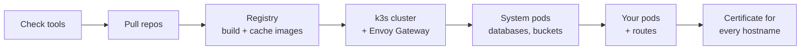

# How auto works

auto is a thin layer over tools you already know: Docker, k3d, k3s, kubectl,
Helm and Envoy Gateway. It runs the commands you would otherwise type, in the
right order, from two kinds of config file.

## The two config files

**`~/.auto/config/local.yaml`** describes your environment: where code goes,
which services to run, which system pods are available, and which images to
keep cached. There is one per machine, often shared by a team through a
[project repo](../guides/teams.md). See the [reference](../reference/local-yaml.md).

**`.auto/` in each service's repo** describes that service: how to deploy it,
which databases it needs, how to seed them, and the hostnames it answers on.
It travels with the code, so the service's own team keeps it up to date.

```text
~/.auto/config/local.yaml          your-service/
  code: ~/source/devocho             Dockerfile
  pods:                              .auto/
    - repo: .../your-service.git       config.yaml    how to deploy it
    - repo: .../another-service.git    helm/          or plain YAML
  system-pods: [...]                   routes.yaml    its hostnames
```

## What `auto start` does



1. **Check tools.** Docker, k3d, kubectl and (with HTTPS) mkcert must be
   installed and working.
2. **Pull.** Each repo is cloned, or pulled if it is already in the code
   folder. A repo with uncommitted changes is left alone, and a pull only
   fast-forwards, so local commits are never lost.
3. **Registry.** A local registry, `k3d-registry.local:12345`, holds your
   images and caches every third-party image the cluster uses, so the next
   start doesn't download them again. A repo's `Dockerfile` is built into an
   image named after the repo and tagged with the `version` in its
   `.auto/config.yaml`, when the registry doesn't have that version yet.
4. **Cluster.** A new k3s cluster in Docker (one server and one agent node by
   default), or the existing one resumed. Your code folder is mounted into
   every node at `/mnt/code`. Envoy Gateway is installed with one shared
   Gateway, `auto`, that every service's routes attach to.
5. **System pods.** The databases and services your pods ask for (MySQL,
   Postgres, Redis, MinIO, Mailpit and others) start, then auto creates the
   databases and buckets each pod named.
6. **Your pods.** Each one is deployed with its own command, `helm install`
   or `kubectl apply`, then its `.auto/routes.yaml` is applied.
7. **Certificate.** auto reads every hostname the routes declare and issues
   one certificate that covers them all. Envoy picks it up live.
8. **Cache.** Third-party images found running in the cluster are pushed to
   the registry and added to `local.yaml`'s `registry:` list for next time.

At the end it prints each URL and the `/etc/hosts` lines you are missing.

## Where things live

| What | Where |
| --- | --- |
| auto, its manifests and your config | `~/.auto/` (`auto`, `k3s/`, `config/local.yaml`) |
| Your services' code | The `code:` folder, mounted in the cluster at `/mnt/code` |
| Images | The `k3d-registry.local` container, kept when the cluster is deleted |
| Cluster | Docker containers named `k3d-k3s-default-*` |
| kubectl context | `k3d-k3s-default`, set as current by `auto start` |
| Database data | Inside the cluster's nodes; deleted with the cluster |

## Ports on your machine

| Port | What |
| --- | --- |
| 80, 443 | Every service, through Envoy Gateway (with `https: true`) |
| 8088 | Every service over plain HTTP (with `https: false`) |
| 3306, 5432, 6379, 1433 | MySQL, Postgres, Redis and SQL Server, when they run |
| 6550 | The Kubernetes API |
| 12345 | The image registry |

They listen on `127.0.0.1`, so nothing here is reachable from your network.
To share a setup with other machines, see
[`bind-address`](../reference/local-yaml.md#bind-address).

A database port already in use on your machine is skipped with a warning,
along with that database.
